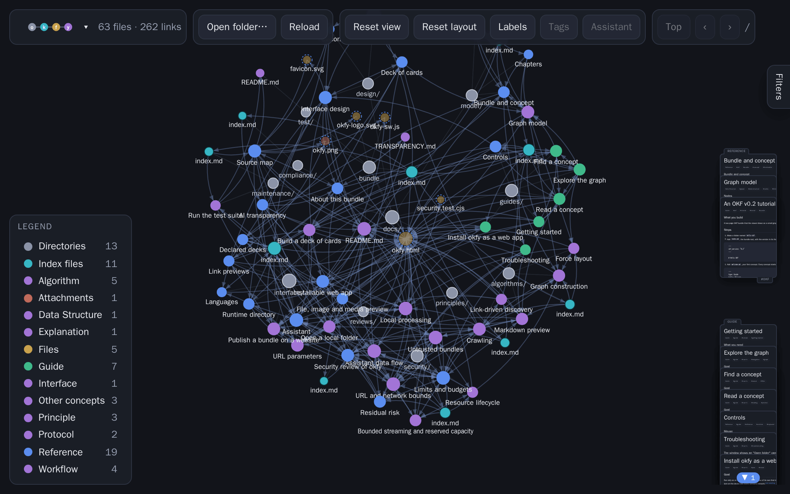

# okfy


> This software is currently in draft and may change.

> This tool was generated with AI assistance.

okfy is a tool for exploring [Open Knowledge Format (OKF)](https://github.com/GoogleCloudPlatform/open-knowledge-format) bundles in your web-browser. All files are processed locally.



### Hosted on okfy.no

Visit https://okfy.no/ to try it now.

### In local web-browser

> Note: installation is recommended in root folder of an OKF bundle.

1. Copy `okfy.html` to local folder.
2. Open html file in browser.
3. Select local folder to browse.

### Install as a web app on local computer

> Note: installing requires HTTPS (or `localhost`) and the companion files
> `favicons/site.webmanifest` and `okfy-sw.js`, published next to `okfy.html`.
> A copy with only `okfy.html` still runs in the browser, without installation.

1. Open the published page over HTTPS.
2. Use the browser's install command:
   - Chrome or Edge (desktop): the install icon in the address bar, or the ⋮
     menu → *Install*. okfy also shows an **Install** button once the browser
     offers installation.
   - Chrome (Android): ⋮ menu → *Install app* (or *Add to Home screen*).
   - Safari (iOS/iPadOS 16.4+): *Share* → *Add to Home Screen*.
   - Safari (macOS 14+): *File* → *Add to Dock*.
3. Launch okfy from the installed icon; it opens in its own window.

The optional `okfy-sw.js` service worker caches only the app shell, so an
installed okfy starts offline. A served bundle still needs the network; a
bundle opened from disk works offline by itself. See
[Install okfy as a web app](docs/guides/install-as-web-app.md).

### URL parameters

Optional; append to the URL and combine as needed (e.g. `?start=guide.md&depth=1`).

| Parameter | Values | Default | Description |
| --- | --- | --- | --- |
| `start` | file in the root folder | `index.md` | Crawl entry point. |
| `depth` (or `levels`) | `0`…`n`, or `all` | `all` | Link levels to prefetch; nodes with unloaded content (pages, files or attachments) show a dashed ring and load on click. |

- The bundle is the page root: the tool loads the `index.md` beside `okfy.html` and follows links (no manifest, no `bundle` parameter). `start` must be same-origin and inside the root.
- The crawl loads only Markdown files. Other files (non-Markdown text and binary attachments) are shown as nodes and fetched on demand when clicked.
- On `file://`, nothing auto-loads — open a folder instead. `depth` also applies to locally opened folders (deeper files revealed one level at a time).

### Declared decks

A bundle can ship decks: each page names the decks it belongs to in frontmatter,
and the viewer groups those pages into decks when the bundle loads:

```yaml
okfx:
  decks: [Tour]
```

A page may name several decks (`decks: [Tour, Model]`), and any deck name a page
uses becomes a deck holding every page that names it. Decks are created and filled
in as the bundle loads, and at most eight decks are built.

### Assistant (optional)

okfy includes an assistant, enabled by default on a desktop layout (open at
startup, with the filter panel collapsed); the toolbar's **Assistant** button
toggles it. Ask it questions about the loaded
bundle; it calls an LLM provider you configure
(DeepSeek, Mistral, Azure OpenAI, a local llama.cpp server, or any
OpenAI-compatible endpoint) and can search and read concepts to ground its answers.

- It sends nothing until you ask a question, or open the
  model field's picker to list the provider's own models.
- On startup it is given the viewer's own instructions for working inside okfy, in
  the AGENTS.md convention; the same text is the generated `.runtime/AGENTS.md` page,
  and its session statistics are on the generated `.runtime/assistant.md` page.
- Your prompt and the concepts the tools return are sent to the provider; the API
  key is kept in memory unless you choose to remember it.
- The provider calls (the chat request and the optional model listing) are the only
  outbound requests. The page's CSP allows `connect-src` for `https` (and `http` on
  localhost) so the assistant can reach it; all bundle requests stay same-origin.
- The panel is resizable (drag its left edge); the filter panel starts collapsed
  and can be reopened to its left.
- A budget symbol beside the token counter sets a session budget (with presets);
  once it is spent the symbol warns and a new question stops until you raise it.
- A speaker toggle in the header turns audio output on: the assistant can then speak
  a short summary through a text-to-speech model it calls with a `speak` tool, and
  an inline speaker in the input prompt interrupts playback.

See [Assistant](docs/interface/assistant.md) and
[Assistant data flow](docs/security/assistant-data-flow.md).

### AI transparency

okfy is developed with AI assistance, under human instruction and review, and its
optional assistant is an AI system. [AI transparency](TRANSPARENCY.md) states what
that means: the assistant talks to a model you configure and its answers are
AI-generated and can be wrong, nothing is sent until you ask, and the project makes
no automated decisions about you. The bundled documentation is AI-assisted and
human-reviewed, and the tool's About panel links to the same statement.
